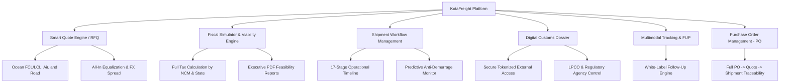

# KotaFreight (KotaComex)
### Enterprise B2B SaaS Platform for International Freight Management, Customs Intelligence, and Multimodal Operations

---

## Access & Links

- **Live Platform:** [kotafreight.com](https://kotafreight.com/)
- **Company LinkedIn:** [linkedin.com/company/kotafreight](https://www.linkedin.com/company/kotafreight/)

---

<p align="center">
  
</p>

<p align="center">
  
</p>

---

## 1. Executive Summary

**KotaFreight** (KotaComex) is a production-grade, multi-tenant B2B SaaS platform engineered to digitize, standardize, and automate the end-to-end lifecycle of **Foreign Trade (COMEX)** and **International Multimodal Logistics**.

The platform operates as a centralized operational hub interconnecting four critical ecosystem actors:
- **Importers and Cargo Owners (BCOs):** Purchase Order (PO) tracking, multimodal Request for Quotation (RFQ) generation, landed-cost fiscal simulations, and comprehensive shipment governance.
- **Freight Forwarders and Logistics Providers:** Algorithmic RFQ equalization, automated rate quotation dispatch to overseas agent networks, local destination charge management, and custom-branded (White-Label) Follow-Up (FUP) distribution.
- **Customs Brokers (Despachantes Aduaneiros):** Centralized digital dossier access, regulatory compliance validation, and LPCO (Licenses, Permits, Certificates, and Others) administration via tokenized secure access.
- **Administration and Controllership:** Subscription billing cycles, multi-tier tenant management, commercial contract governance, and audit logging.

---

## 2. Technology Stack and Engineering Decisions

The platform was architected with a strict focus on relational data integrity, multi-tenant security isolation, server-side performance optimization, and end-to-end type safety.

| Layer | Technology | Architectural Rationale |
| :--- | :--- | :--- |
| **Full-Stack Framework** | Next.js (App Router) | Server Components for minimal client-side overhead, Server Actions for secure transactional mutations, and Route Handlers for external webhooks and integrations. |
| **Language** | TypeScript | Strict end-to-end typing ensuring absolute consistency between database entities, complex business rules, and UI components. |
| **UI & Styling** | React, Vanilla CSS, CSS Modules | Pixel-perfect layout control without heavy external UI component runtime overhead, featuring accessible high-contrast corporate typography and reactive micro-interactions. |
| **Data Layer & ORM** | PostgreSQL, Prisma ORM | Relational schema with over 25 normalized entities, ACID transactional guarantees, explicit foreign key cascade controls, and customized typed client generation. |
| **Object Storage** | Supabase Storage | Highly available and secure object storage for sensitive customs documents (Commercial Invoices, Packing Lists, BLs, AWBs, and contracts) using time-limited signed URLs. |
| **Document Generation** | Node.js Buffer Engines | Programmatic rendering of high-density operational PDFs for Customs Dossiers, Fiscal Viability Studies, and Purchase Order records. |
| **Transactional Email** | Resend API | Reliable multi-party dispatch engine supporting responsive HTML templates, bilingual messaging (English and Portuguese), and automated team CC distribution. |
| **Security & Authentication** | Bcrypt, 2FA, Encrypted Sessions | Logical tenant isolation, cryptographic credential hashing, Two-Factor Authentication (2FA), and secure expirable token links for external non-authenticated stakeholders. |

---

## 3. Artificial Intelligence Architecture (Core Focus)

The conception, engineering, and feature set of KotaFreight deeply integrate Artificial Intelligence across two complementary dimensions: **Agentic Software Engineering (Development Acceleration)** and **Applied Product Intelligence (Domain-Specific Automation & LLM Architecture)**.

### 3.1. Agentic Software Engineering and AI-Driven Architecture

Delivering an enterprise-grade platform of this complexity was enabled by advanced AI-assisted engineering methodologies and autonomous agentic workflows:

- **Architectural Decomposition & Domain-Driven Design (DDD):** Deconstructed intricate Brazilian customs legislation (cascading import duties, "grossed-up" state tax bases, and maritime demurrage rules) into modular, deterministic software abstractions guided by high-precision AI prompts.
- **Context Window Orchestration & Type Contracts:** Maintained strict architectural integrity across multi-file refactoring sessions by orchestrating code generation against strict TypeScript interfaces and schema-first Prisma specifications, preventing technical debt and API drift.
- **Automated Defensive Engineering:** Leveraged LLM pair-programming agents to systematically generate data sanitization routines, defensive boundary validations, migration integrity tests, and error boundaries across all server actions.

### 3.2. Applied Algorithmic and Heuristic Domain Intelligence

- **Harmonized System (HS / NCM) Intelligent Classification Engine:**
  - Real-time integration with Brazilian Siscomex regulatory APIs, augmented by an in-memory caching tier and fallback resilience.
  - Hybrid matching engine combining 8-digit exact numerical parsing, query normalization, and semantic keyword matching across official customs descriptions.
  - Automatic hierarchical traversal across the Harmonized System structure, resolving 21 Sections (I to XXI) and 97 official Chapters instantaneously.
  - Early-stage detection of regulatory agency interventions (ANVISA, MAPA, INMETRO) and mandatory product attribute requirements under the New Duimp (Single Import Declaration) catalog.

- **Cascading Multi-Variable Landed Cost Engine:**
  - Proprietary algorithm executing simultaneous tax calculations adhering to strict Brazilian constitutional hierarchy and tax computation rules:
    1. CIF Base determination (FOB Cargo Value + International Freight + Marine/Air Cargo Insurance).
    2. Import Duty (II - Imposto de Importacao).
    3. Excise Tax (IPI - Imposto sobre Produtos Industrializados) calculated ad valorem over (CIF + II).
    4. Federal Social Contributions (PIS-Importacao and COFINS-Importacao) with statutory deduction bases.
    5. State Value-Added Tax (ICMS) calculated with state-specific gross-up formulas ("calculo por dentro") configured dynamically by port/state of customs clearance.
    6. Merchant Marine Renewable Surcharge (AFRMM) applied specifically to ocean freight operations.
  - Real-time conversion to national currency (BRL) with automated spread calculation and unit landed-cost projection per item.

- **Predictive Anti-Demurrage and Detention Monitor:**
  - Continuous algorithmic monitoring of container Free Time burn rates relative to verified port discharge dates.
  - Automated severity-based risk scoring and alerting to prevent catastrophic demurrage penalties in port terminal operations.

### 3.3. Foundation Model and Multimodal LLM Architecture

The core infrastructure of KotaFreight incorporates integration pipelines prepared for Multimodal Vision-Language Models (VLMs) and Retrieval-Augmented Generation (RAG):

```
[Customs Document (PDF / Image)]
               │
               ▼
   [OCR & Vision LLM Pipeline]
               │
               ▼
[Structured Entity Extraction via Zod / JSON Schema]
 (Invoice Number, Incoterm, Currency, Items, NCM, Gross Weight)
               │
               ▼
  [Regulatory Compliance RAG] ◄── [Vector Database: Customs Norms & Duimp]
               │
               ▼
[Automated Validation & Ingestion into PostgreSQL Database]
```

- **Multimodal Customs Document Ingestion:** Architectural pipeline designed for processing unstandardized Commercial Invoices, Packing Lists, and Bills of Lading (BL/AWB), parsing visual data directly into structured, type-safe database records via structured LLM function calling.
- **Retrieval-Augmented Generation (RAG) for Customs Compliance:** Vector search architecture indexing thousands of official regulatory rulings (Instrucoes Normativas da Receita Federal, Portarias Secex, and Cosit solutions) to provide automated compliance checks and legal justification notes prior to official customs transmission.

---

## 4. Functional Platform Modules



### Module 1: Smart Quote Engine (Multimodal RFQ)
- Concurrent, individualized request dispatch to global overseas forwarder networks.
- Native bilingual support (Portuguese and English) for seamless cross-border communication.
- Full multimodal parameterization: Ocean FCL/LCL (equipment types, cubic meters, weight), Air Freight (stackability, volumetric weight ratio), and Dedicated Road Freight.
- Automated rate equalization: unified comparison of origin charges, ocean/air base freight, destination port charges (THC, handling), transit times, and currency spreads.
- Rigorous data sanitization preventing client commercial identity leakage to sub-tier carriers.

### Module 2: Fiscal Simulator and Financial Viability Studies
- Automated calculation of all Brazilian import duties (II, IPI, PIS, COFINS, ICMS, and AFRMM).
- Strategic scenario modeling evaluating exchange rate fluctuations, port alternatives, and multimodal options.
- Dynamic generation of executive-grade PDF viability studies for procurement boards and finance directors.

### Module 3: Operational Shipment Workflow (17-Stage Journey)
- Standardized end-to-end operational timeline:
  `Quotation Request -> Booking -> Cargo Pickup -> Stuffing -> Origin Customs Clearance -> On Board -> In Transit -> Port Arrival -> Cargo Presence Registration -> Duimp/DI Filing -> Customs Clearance -> Terminal Loading -> Final Plant Delivery`.
- Centralized milestone logging, operational notes, and automated deadline tracking.

### Module 4: Digital Customs Broker Dossier
- Unified secure repository for core international shipping documentation: Commercial Invoices, Packing Lists, Bills of Lading (BL), Air Waybills (AWB), Certificates of Origin, and FX exchange contracts.
- Regulatory requirement monitoring across Brazilian intervention bodies (ANVISA, MAPA, INMETRO, ANATEL).
- External tokenized access allowing external customs brokers to inspect and download dossier files securely without requiring full platform credentials.

### Module 5: Multimodal Tracking and White-Label Follow-Up (FUP)
- Automated milestone monitoring across ocean and air containerized cargo via webhook ingestion.
- White-label Follow-Up dispatch system allowing freight forwarders to apply their own corporate logo, brand colors, custom signatures, and sender domains.

### Module 6: Integrated Purchase Order (PO) Management
- Full supply chain traceability linking initial overseas Purchase Orders directly to subsequent RFQs and finalized shipments.
- SKU catalog with historical FOB unit pricing, tariff classifications, package dimensions, and foreign manufacturer details.

---

## 5. Relational Data Modeling and Database Architecture

The relational schema maintained via **Prisma ORM** comprises over 25 interconnected tables engineered for data integrity, index efficiency, and multi-tenant isolation:

```
Simplified Relational Schema:

[ClientCompany] 1 ──── ∞ [User]
       │
       ├──── ∞ [Quotation] 1 ──── ∞ [Bid] 1 ──── ∞ [BidExpense]
       │            │
       │            ├──── 1 [Embarque] 1 ──── ∞ [OperationalStages]
       │            └──── ∞ [SmartQuoteRequest] 1 ──── ∞ [SmartQuoteRecipient]
       │
       ├──── ∞ [PurchaseOrder] 1 ──── ∞ [PurchaseOrderItem]
       │            │
       │            └──── 1 [DossieDespachante] 1 ──── ∞ [DossieDocument]
       │
       ├──── ∞ [TrackingShipment] 1 ──── ∞ [TrackingEvent]
       │
       └──── 1 [Contract] 1 ──── ∞ [Cobranca] 1 ──── ∞ [PaymentHistory]

[Provider] 1 ──── ∞ [ProviderGroupEmail]
    │
    ├──── 1 [FornecedorPlano] 1 ──── ∞ [FornecedorConsumo]
    ├──── ∞ [SmartQuotePartner]
    └──── 1 [ProviderEmailBrand (White-Label)]
```

### Core Database Engineering Patterns:
- **Explicit Foreign Key Cascades:** Eradication of orphaned records and strict enforcement of referential cleanup.
- **Composite Unique Constraints:** Prevention of duplicate state collisions across multi-tenant relationships (e.g., company-partner scopes, monthly consumption quotas, and user-tenant allocations).
- **Multi-Currency Precision:** Granular tracking of transactional currencies (USD, EUR, BRL) alongside captured exchange rates to ensure deterministic retrospective financial auditing.

---

## 6. Enterprise Security, Governance, and Multi-Tenancy

- **Multi-Tenant Logical Isolation:** Complete data separation across importer companies and logistics providers enforced at the query level across all server actions.
- **Access Control & Cryptography:** Bcrypt hashing with secure salt rounds, HTTP-only authenticated session cookies, and Two-Factor Authentication (2FA).
- **Data Protection & Sanitization:** Systematic masking of commercial client data before exporting RFQ payloads to external vendors.
- **Audit Trails:** Immutable audit logging capturing administrative operations, plan modifications, and permission overrides.

---

## 7. Intellectual Property and Commercial Disclaimer

This repository serves strictly as an **architectural, technical, and engineering portfolio demonstration**.

Because KotaFreight is an active proprietary commercial SaaS product, the full underlying source code, production infrastructure credentials, and internal production database schemas remain strictly confidential and protected by intellectual property laws.

For architectural inquiries, product demonstrations, or technical collaboration:
- **Author / Lead Engineer:** Mateus Oliveira
- **Platform Website:** [kotafreight.com](https://kotafreight.com/)
- **LinkedIn Profile:** [linkedin.com/company/kotafreight](https://www.linkedin.com/company/kotafreight/)
- **Engineering Domain:** Full-Stack Software Architecture, Agentic AI Engineering, and Enterprise B2B Foreign Trade Systems
