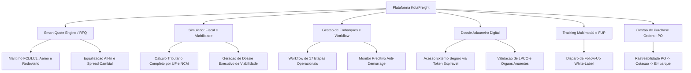

# KotaFreight (KotaComex)
### Plataforma SaaS B2B de Gestao de Fretes Internacionais, Inteligencia Aduaneira e Rastreamento Operacional

---

## 1. Sumario Executivo

O **KotaFreight** (KotaComex) e uma plataforma SaaS B2B corporativa desenvolvida para digitalizar, padronizar e automatizar integralmente o ciclo de operacoes de **Comercio Exterior (COMEX)** e **Logistica Internacional Multimodal**.

O sistema atua como um ecossistema integrado que conecta tres atores operacionais centrais:
- **Importadores e Donos de Carga (BCOs):** Gestao de Purchase Orders (PO), emissao de RFQs multimodais, simulacao de custos de importacao e acompanhamento ponta a ponta.
- **Agentes de Carga (Freight Forwarders):** Equalizacao de fretes internacionais, disparo automatizado de cotacoes para parceiros internacionais, gestao de taxas locais e geracao de Follow-Up (FUP) com identidade visual personalizada (White-Label).
- **Despachantes Aduaneiros:** Acesso centralizado e seguro ao dossie documental com validacao de licencas e orgaos anuentes (LPCO).
- **Controladoria e Administracao:** Painel financeiro, gestao de contratos corporativos, faturamento de assinaturas e auditoria de permissoes.

---

## 2. Stack Tecnologica e Decisoes de Engenharia

A arquitetura foi desenhada priorizando integridade relacional, seguranca em ambiente multi-tenant, renderizacao eficiente no lado do servidor e tipagem estrita de ponta a ponta.

| Camada | Tecnologia | Justificativa Arquitetural |
| :--- | :--- | :--- |
| **Framework Full-Stack** | Next.js (App Router) | Server Components para otimizacao de performance, Server Actions para mutacoes seguras e rotas de API dedicadas para webhooks e integracoes. |
| **Linguagem** | TypeScript | Tipagem estrita end-to-end garantindo consistencia entre o banco de dados, regras de negocio e componentes visuais. |
| **Interface & Componentes** | React, Vanilla CSS, CSS Modules | Controle milimetrico de layout sem dependencia pesada de bibliotecas de terceiros, com microinteracoes reativas e alto contraste corporativo. |
| **Camada de Dados & ORM** | PostgreSQL, Prisma ORM | Modelagem relacional com mais de 25 entidades normalizadas, transacoes atomicas ACID e geracao de cliente tipado sob medida. |
| **Armazenamento de Arquivos** | Supabase Storage | Armazenamento de alta disponibilidade para documentacao aduaneira sensivel (Invoices, Packing Lists, BLs, AWBs e contratos) com URLs assinadas e expiraveis. |
| **Motor de Geracao de Documentos** | Node.js Buffer Engines | Geracao programatica de relatorios PDF de alta densidade de dados para Dossies Aduaneiros, Estudos de Viabilidade Tributaria e Pedidos de Compra. |
| **Comunicacoes Transacionais** | Resend API | Disparos transacionais confiaveis com templates HTML responsivos, suporte bilingue nativo (PT/EN) e multiplas copias funcionais (CC de equipe). |
| **Seguranca & Autenticacao** | Bcrypt, 2FA, Sessao Criptografada | Isolamento logico de inquilinos (multi-tenancy), hash seguro de credenciais, segundo fator de autenticacao e tokens temporarios com expiracao para terceiros. |

---

## 3. Arquitetura de Inteligencia Artificial (Destaque Principal)

O desenvolvimento do KotaFreight incorpora a Inteligencia Artificial em dois niveis estrategicos: **no processo de engenharia de software acelerada (Engenharia Agentica)** e **na inteligencia analitica e preditiva do produto final**.

### 3.1. Engenharia de Software Acelerada por IA (Agentic Software Engineering)

A construcao desta plataforma de alta complexidade em curto espaco de tempo foi viabilizada pelo dominio avancado de metodologias de desenvolvimento orientadas por IA:

- **Decomposicao Arquitetural e Domain-Driven Design (DDD):** Traducao de regras complexas de Comercio Exterior brasileiro (aliquotas em cascata, bases de calculo "por dentro", rotinas de desembaraco e prazos de Demurrage) em especificacoes modulares executaveis por agentes de codigo.
- **Engenharia de Prompt Estruturada:** Uso de prompts contextuais e tecnicos com especificacoes precisas de esquemas de banco, contratos de interface TypeScript e fluxos assincronos, minimizando alucinacoes e garantindo aderencia total as melhores praticas de mercado.
- **Orquestracao de Contexto e Refatoracao Concorrente:** Gestao consciente da janela de contexto para orquestrar criacao de tabelas relacionais, integracoes de endpoints REST e validacoes de negocio sem introduzir dividas tecnicas ou quebras de compatibilidade.
- **Garantia de Qualidade Deterministica:** Geracao automatizada de rotinas de higienizacao de dados, scripts de saneamento e validacoes rigorosas de input para prevencao de falhas em tempo de execucao.

### 3.2. Inteligencia Algoritmica e Heuristica no Produto

- **Motor de Classificacao Fiscal NCM & Sistema Harmonizado:**
  - Integracao em tempo real com APIs oficiais do Siscomex com mecanismo de cache em memoria e camada de contingencia resiliente.
  - Algoritmo de busca hibrida (correspondencia numerica exata de 8 digitos, normalizacao de caracteres e busca semantica por palavras-chave na descricao da mercadoria).
  - Resolucao automatica da arvore hierarquica do Sistema Harmonizado: mapeamento instantaneo de 21 Secoes (I a XXI) e 97 Capitulos aduaneiros oficiais.
  - Identificacao preliminar de exigencias regulatorias e atributos mandatorios exigidos pelo Catalogo de Produtos da Nova Duimp (Declaracao Unica de Importacao).

- **Motor de Calculo Tributario em Cascata:**
  - Algoritmo de apuracao tributaria simultanea respeitando a ordem juridica de incidencia:
    1. Base CIF (Valor FOB + Frete Internacional + Seguro Internacional).
    2. Imposto de Importacao (II).
    3. Imposto sobre Produtos Industrializados (IPI) com base ad valorem sobre CIF + II.
    4. PIS e COFINS-Importacao com regras especificas de desoneracao e alinhamento federal.
    5. ICMS Estadual com calculo de base dupla ("calculo por dentro"), parametrizado pelas regras fiscais de cada Unidade Federativa de desembaraco (SP, SC, ES, PR, etc.).
    6. Adicional ao Frete para Renovacao da Marinha Mercante (AFRMM) incidente nas operacoes maritimas.
  - Projecao instantanea do Custo Total em Moeda Nacional (BRL) e do Custo Unitario Nacionalizado por item.

- **Motor Preditivo Anti-Demurrage (Free Time Monitoring):**
  - Calculo continuo e preditivo da queima de dias livres (*Free Time*) a partir da data efetiva de atracacao e descarga do conteiner.
  - Sistema de alertas automatizados por severidade para mitigar custos diarios desproporcionais com sobre-estadia de conteineres no porto.

### 3.3. Arquitetura para Integracao com Modelos de Linguagem e Visao (LLMs & VLMs)

A base do KotaFreight foi projetada com interfaces preparadas para expansao com Modelos de Fundacao de ultima geracao:

```
[Documento COMEX (PDF/Imagem)]
          │
          ▼
[Pipeline de OCR & Vision LLM]
          │
          ▼
[Extracao de Entidades Estruturadas via JSON Schema / Zod]
    (Invoice Number, Incoterm, Moeda, Itens, Peso, NCMs)
          │
          ▼
[RAG Regulatorio Aduaneiro] ◄── [Base Vetorial: INs RFB, Decretos, Duimp]
          │
          ▼
[Validacao de Conformidade & Insercao Direta no Banco PostgreSQL]
```

- **Extracao Multimodal de Documentos Aduaneiros:** Pipeline arquitetural para ingestao de Faturas Comerciais (*Commercial Invoices*), Listas de Carga (*Packing Lists*) e Conhecimentos de Embarque (*Bill of Lading / AWB*), convertendo documentos nao-estruturados em modelos relacionais tipados via Function Calling / Structured Outputs.
- **RAG para Compliance Regulatorio (Duimp):** Arquitetura para recuperacao contextual baseada em embeddings vetorizados sobre Instrucoes Normativas da Receita Federal do Brasil e Portarias Secex, permitindo auditoria preventiva de classificacoes fiscais antes da transmissao oficial.

---

## 4. Modulos Funcionais do Sistema



### Modulo 1: Smart Quote Engine (Motor de RFQ Multimodal)
- Disparo simultaneo e individualizado de cotacoes para redes de parceiros comerciais globais.
- Suporte a idiomas nativos (Portugues e Ingles), garantindo comunicacao fluida com agentes de carga internacionais.
- Parametrizacao completa para Maritimo (FCL/LCL), Aereo (empilhamento, dimensoes e relacao peso taxavel) e Rodoviario dedicado.
- Equalizacao automatizada de propostas recebidas: comparacao de taxas de origem, frete basico, taxas locais no destino (THC, Capatazia), transit time e validade de tarifa.
- Sanitizacao rigorosa de dados: protecao contra vazamento de identidade de clientes finais para sub-fornecedores.

### Modulo 2: Simulador Tributario e Estudo de Viabilidade Financeira
- Apuracao instantanea de II, IPI, PIS, COFINS, ICMS por estado e AFRMM.
- Comparativos de cenarios logisticos (impacto de variacao cambial, diferentes portos de entrada e alternativas de frete).
- Geracao automatizada de estudos de viabilidade financeira em PDF estruturado para apresentacao a comites de suprimentos e diretorias.

### Modulo 3: Gestao Operacional de Embarques (Workflow de 17 Etapas)
- Timeline operacional padronizada cobrindo:
  `Solicitacao -> Cotacao -> Booking -> Coleta -> Estufagem -> Desembaraco Origem -> Embarque -> Em Transito -> Chegada ao Destino -> Presenca de Carga -> Registro DI/Duimp -> Desembaraco Aduaneiro -> Carregamento -> Entrega na Fabrica`.
- Centralizacao de observacoes operacionais e notificacoes de marcos criticos.

### Modulo 4: Dossie Aduaneiro Digital do Despachante
- Repositorio unificado para documentos vitais da operacao: Commercial Invoice, Packing List, Bill of Lading (BL), AWB, Certificados de Origem e Comprovantes de Pagamento.
- Mapeamento de licencas de importacao e anuencias regulatorias (ANVISA, MAPA, INMETRO, ANATEL).
- Compartilhamento externo sem necessidade de login via links seguros gerados por tokens criptografados com prazo de expiracao controlado.

### Modulo 5: Tracking Multimodal e Follow-Up (FUP) White-Label
- Monitoramento de status de cargas maritimas e aereas com integracoes de webhooks.
- Gerador de Follow-Up (FUP) com suporte completo a White-Label para agentes de carga: customizacao de logomarca, paleta de cores corporativa, assinatura e canal de comunicacao.

### Modulo 6: Gestao Integrada de Purchase Orders (PO)
- Rastreabilidade desde o pedido de compras internacional ate a chegada dos itens no estoque.
- Catalogo de SKUs com historico de precos FOB, classificacao fiscal, volumes e relacao com fornecedores internacionais.

---

## 5. Modelagem de Dados e Engenharia de Banco

O esquema relacional mantido via **Prisma ORM** possui mais de 25 tabelas estruturadas com foco em integridade referencial, desempenho de indices e isolamento multi-tenant:

```
Esquema Relacional Simplificado:

[ClientCompany] 1 ──── ∞ [User]
       │
       ├──── ∞ [Quotation] 1 ──── ∞ [Bid] 1 ──── ∞ [BidExpense]
       │            │
       │            ├──── 1 [Embarque] 1 ──── ∞ [EtapasOperacionais]
       │            └──── ∞ [SmartQuoteRequest] 1 ──── ∞ [SmartQuoteRecipient]
       │
       ├──── ∞ [PurchaseOrder] 1 ──── ∞ [PurchaseOrderItem]
       │            │
       │            └──── 1 [DossieDespachante] 1 ──── ∞ [DossieDocument]
       │
       ├──── ∞ [TrackingShipment] 1 ──── ∞ [TrackingEvent]
       │
       └──── 1 [Contract] 1 ──── ∞ [Cobranca] 1 ──── ∞ [HistoricoPagamento]

[Provider] 1 ──── ∞ [ProviderGroupEmail]
    │
    ├──── 1 [FornecedorPlano] 1 ──── ∞ [FornecedorConsumo]
    ├──── ∞ [SmartQuotePartner]
    └──── 1 [ProviderEmailBrand (White-Label)]
```

### Principais Praticas Aplicadas na Modelagem:
- **Chaves Estrangeiras com Politicas de Cascata Explicitas:** Eliminacao de dados orfaos e garantia de exclusao logica ou fisica segura.
- **Restricoes Unicas Compostas:** Prevencao de duplicidade em relacionamentos criticos (ex.: empresa-parceiro, ciclo-consumo, usuario-empresa).
- **Tratamento de Moedas e Flutuacao Cambial:** Armazenamento granular de moedas de origem (USD, EUR, BRL) e taxas de cambio aplicadas para auditoria financeira retroativa.

---

## 6. Seguranca, Conformidade e Governanca

- **Isolamento Multi-Tenant:** Segregacao estrita de dados por empresa importadora e agente de carga em todas as queries e Server Actions.
- **Autenticacao e Criptografia:** Hashing de senhas via Bcrypt com salt rounds adequados, sessao segura via cookies HTTP-only e autenticacao de dois fatores (2FA).
- **Protecao de Dados Sensiveis:** Mascaramento e sanitizacao de dados comerciais estrategicos ao disparar solicitacoes de cotacao para terceiros.
- **Auditoria Administrativa:** Registro de logs de acoes de administradores para rastreabilidade de alteracoes de planos, cobrancas e liberacoes de modulos.

---

## 7. Aviso de Propriedade Intelectual e Contato

Este repositorio tem o proposito exclusivo de **demonstracao arquitetural, tecnica e de competencias de engenharia de software e inteligencia artificial**.

Por se tratar de um produto comercial proprietario (SaaS B2B ativo), o codigo-fonte completo, as chaves de infraestrutura de producao e os esquemas internos completos sao mantidos sob sigilo comercial e protegidos por direitos autorais.

Para discussoes sobre a arquitetura do projeto, oportunidades profissionais ou demonstracao guiada do produto:
- **Autor / Engenheiro:** Mateus Oliveira
- **Ambito do Projeto:** Arquitetura de Software Full-Stack, Engenharia de IA e Solucoes B2B para Comercio Exterior
